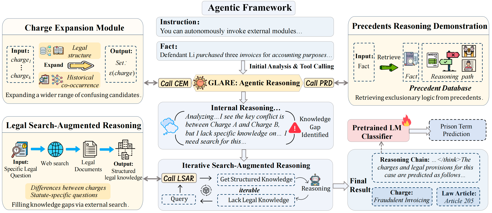

## 💡 Overview

Although Large Language Models (LLMs) have achieved remarkable progress in general reasoning, they struggle with tasks that require fine-grained distinctions between similar charges. These models often select plausible charges directly without discriminating among closely related alternatives. In this paper, we introduce GLARE, an agentic legal reasoning framework that enables models to actively retrieve and apply external knowledge during decision-making. Unlike static prediction, GLARE simulates comparative reasoning by dynamically expanding the decision space to include confusing candidates, then retrieving exclusionary logic from precedents and statutes to identify the correct judgment.

## 🧩 Method
We propose GLARE (*A**G**entic **L**eg**A**l **R**easoning Fram**E**work*), an agentic framework that reframes legal judgment as an active comparative reasoning process rather than passive prediction. GLARE explicitly externalizes the discrimination process through three integrated modules. 

- **Charge Expansion Module**: Expands a diverse set of confusing charges by leveraging multiple signals, such as legal structure and historical co-occurrence. This helps the model compare a wider range of candidates and avoid premature conclusions.
- **Precedents Reasoning Demonstration**: Extracts discriminative reasoning patterns from similar cases, providing concrete examples that guide the model in distinguishing subtle differences.
- **Legal Search-Augmented Reasoning**: Identifies remaining ambiguities and retrieves specific legal rules when needed to resolve competing charges. We guide the model to focus its search on differences between similar charges and details of how specific laws apply, rather than general case facts.  
  
<p align="center">
  
</p>

## 🔧 Installation
### Environment Setup
```bash
# Create conda environment
conda create -n glare python=3.9
conda activate glare

# Install requirements
cd GLARE
pip install -r requirements.txt
```
## 🏃 Quick Start

### Data Preparation

- **single-defendant scenario:**  
  [CAIL2018 dataset](https://github.com/china-ai-law-challenge/CAIL2018)

- **multi-defendant scenario:**  
  [CMDL dataset](https://github.com/littlebowlnju/CMDL)

### Model Inference

You can run different inference modes using the provided scripts. Below are examples of how to execute each mode:

1. **Direct Reasoning**
```bash
bash direct_reasoning/run.sh
```

2. **Retrieval-augmented Reasoning**
```bash
python retrieval_augmented_reasoning/retrieve.py
bash retrieval_augmented_reasoning/run.sh
```

3. **GLARE(Ours)**
```bash
# Build reasoning paths for ALL precedents, before retrieving any test cases.
python glare/offline_reasoning.py \
    --precedent_database_path ./data/precedent_database.jsonl \
    --output_path ./data/precedent_database_with_reasoning.jsonl \
    --multiljp_file_path "$MULTILJP_FILE_PATH"
vllm serve "model_path" --port 19001 --tensor-parallel-size 2 --gpu-memory-utilization 0.9 --dtype float16 --served-model-name qwq
bash glare/run.sh
```

### GLARE Modules and Preparation

1. **Charge Expansion Module (CEM)**

   Candidate charges are expanded from two complementary perspectives:
   **legal structure-based expansion** retrieves semantically similar charges
   within the same legal chapter and across different chapters using BGE-M3;
   **history-based expansion** retrieves charges that frequently co-occur in
   historical cases. The two expansion sets are combined to provide a broader
   set of candidates for comparative reasoning.

   Specify the co-occurrence corpus with `--multiljp_file_path`. You can prepare
   it from the training splits of multi-defendant, multi-charge datasets such as
   MultiLJP or CMDL. This argument has no default path. Set `MULTILJP_FILE_PATH`
   to your local training JSONL file before running the commands above;
   `glare/run.sh` uses the same environment variable.

2. **Precedents Reasoning Demonstration (PRD)**

   - **Prepare the precedent database.** Collect precedents from the training
     splits of CAIL2018 and CMDL, together with cases collected from China
     Judgments Online. Remove duplicates and exclude evaluation cases. Store
     the corpus at `data/precedent_database.jsonl` or specify its location with
     `--precedent_database_path`.

   - **Generate reasoning paths offline.** Run `glare/offline_reasoning.py` to
     generate a reasoning path for every precedent. Given the case facts, the
     correct judgment, and expanded candidate charges, Qwen2.5-72B-Instruct
     explains why the correct charges apply and why the alternatives should be
     excluded. The script retains the original records and adds
     `reasoning_chain`, writing the enriched corpus to
     `data/precedent_database_with_reasoning.jsonl` by default.

   - **Retrieve precedents online.** `glare/glare.py` uses SAILER and FAISS to
     retrieve five relevant precedents per input case (`--precedent_top_k 5`).
     Their facts and reasoning paths serve as demonstrations for distinguishing
     candidate charges. For repeated experiments, save the FAISS index and its
     corresponding precedent ordering after construction, then load them on
     subsequent runs to avoid rebuilding the index. The current implementation
     builds the index in memory at startup; index persistence needs to be added
     locally.

3. **Legal Search-Augmented Reasoning (LSAR)**

   During reasoning, the model generates targeted legal queries to resolve
   ambiguities between candidate charges or clarify statute-specific questions.
   The system calls the **Serper API** to search the web, fetches relevant page
   content, and summarizes useful legal knowledge before returning it to the
   model for continued reasoning. This search-and-reasoning process can repeat
   as needed, subject to `--max_search_limit` and `--max_turn`.

   Configure your Serper API key in `glare/serper.py`. Webpage fetching through
   Jina is controlled by `--use_jina`, with credentials supplied through
   `--jina_api_key`.

### Evaluation

After obtaining reasoning results from any method (Direct Reasoning,
Retrieval-augmented Reasoning, or GLARE), you can use
`direct_reasoning/summarize.py` to further format the predictions before evaluation.
It supports both single-defendant and multi-defendant cases.

```bash
python direct_reasoning/summarize.py \
    --test_dataset_path "$TEST_DATASET_PATH" \
    --method_name "$METHOD_NAME" \
    --method_model "$METHOD_MODEL" \
    --model_path "$MODEL_PATH"
```

Set `METHOD_NAME` to `llm`, `rag`, or `glare`, and `METHOD_MODEL` to the model
identifier (`7b`, `qwq`, `32b`, or `72b`). The script reads
`output/{method_name}/{method_model}/predict_result` and writes formatted predictions
to `output/{method_name}/{method_model}/generated_result`. For GLARE, use `--method_name glare --method_model qwq`; its raw predictions
are saved directly to `output/glare/qwq/predict_result`.
Configure the evaluation scripts to read the corresponding `generated_result` file.

- For single-defendant dataset:
```bash
python metrics/cal_single_defendant_article_metrics.py
python metrics/cal_single_defendant_charge_metrics.py
```

- For multi-defendant dataset:
```bash
python metrics/multi_defendant_metrics.py
```

## 📄 License

This project is released under the [MIT License](LICENSE).


