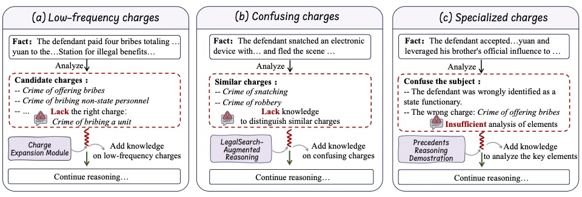
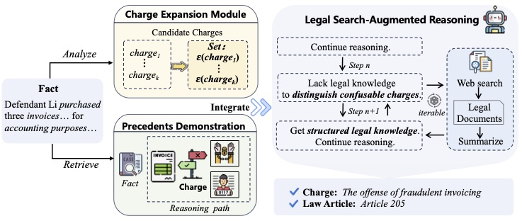

## 💡 Overview

We identify that existing large language models (LLMS) have significant problems of insufficient reasoning due to a lack of legal knowledge. Effective legal analysis requires long-tail legal knowledge, such as determining the applicability of specific statutes. In some cases, this knowledge is even absent from official legal texts. When such information is missing, models struggle to produce complete and trustworthy reasoning chains as shown in the following figure. These observations highlight the need for **domain-specific knowledge augmentation mechanisms** that can dynamically supply essential information during the reasoning process.

<p align="center">
  
</p>

## 🧩 Method
To address the knowledge gaps in legal reasoning, we propose GLARE (*A**G**entic **L**eg**A**l **R**easoning Fram**E**work*), a modular system that enables language models to dynamically acquire key legal knowledge to improve the breadth and depth of reasoning.
- **Charge Expansion Module**: Expands a diverse set of confusing charges by leveraging multiple signals, such as legal structure and historical co-occurrence.
- **Precedents Reasoning Demonstration**: Retrieves the most relevant precedents through semantic search and learns from their reasoning chains via in-context learning.
- **Legal Search-Augmented Reasoning**: Allows the model to detect knowledge gaps and retrieve supporting legal information when needed.

<p align="center">
  
</p>

## 🔧 Installation
### Environment Setup
```bash
# Create conda environment
conda create -n galre python=3.9
conda activate glare

# Install requirements
cd GLARE
pip install -r requirements.txt
```
## 🏃 Quick Start

### Data Preparation

- **single-defendant scenario:**  
  [CAIL2018 dataset](https://github.com/china-ai-law-challenge/CAIL2018)

- **multi-defendant scenario:**  
  [CMDL dataset](https://github.com/littlebowlnju/CMDL)

### Model Inference

You can run different inference modes using the provided scripts. Below are examples of how to execute each mode:

1. **Direct Reasoning**
```bash
bash direct_reasoning/run.sh
```

2. **Retrieval-augmented Reasoning**
```bash
python retrieval_augmented_reasoning/retrieve.py
bash retrieval_augmented_reasoning/run.sh
```

3. **GLARE(Ours)**
```bash
python glare/offline_reasoning.py
vllm serve "model_path" --port 19001 --tensor-parallel-size 2 --gpu-memory-utilization 0.9 --dtype float16 --served-model-name qwq
bash glare/run.sh
```

### Evaluation
- For single-defendant dataset:
```bash
python metrics/cal_single_defendant_article_metrics.py
python metrics/cal_single_defendant_charge_metrics.py
```

- For multi-defendant dataset:
```bash
python multi_defendant_metrics.py
```

## 📄 License

This project is released under the [MIT License](LICENSE).


